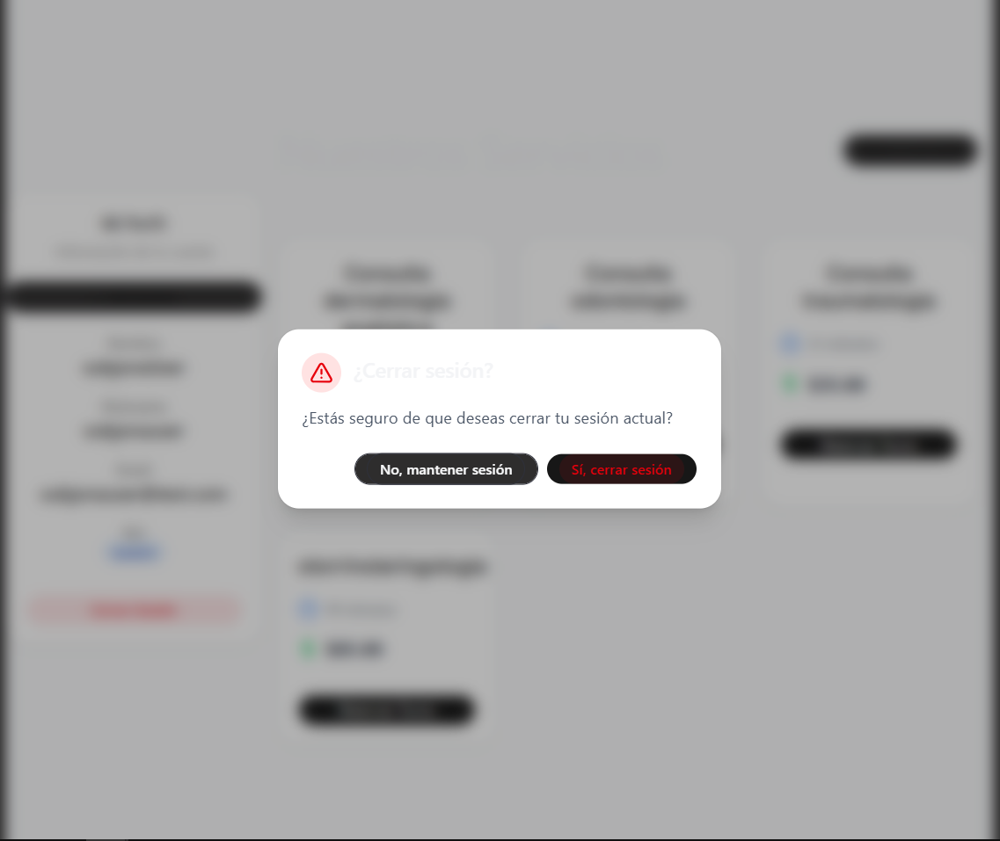

# 🏥 Sistema de Gestión de Turnos Médicos

> Plataforma full-stack para la gestión integral de turnos en consultorios médicos, con roles de administrador y paciente, calendario visual en tiempo real y notificaciones de estado.

---

## 📸 Capturas de Pantalla

### Panel de Administración
| Gestión General | Servicios |
|---|---|
|  |  |

| Turnos | Vaciar Base |
|---|---|
|  |  |

### Vista de Paciente y Funcionalidades
| Mis Turnos | Calendario |
|---|---|
|  |  |

| Gestión de Servicios | Autenticación |
|---|---|
|  |  |

> 💡 Reemplazá las URLs de placeholder con capturas reales de tu proyecto (usá [Lightshot](https://app.prntscr.com/) o subilas a la carpeta `/assets`).

---

## ✨ Características Principales

### 👥 Sistema de Autenticación y Roles
- Registro y login con JWT (JSON Web Tokens)
- Roles diferenciados: **Admin** y **Usuario/Paciente**
- Rutas protegidas con middleware de autorización
- Persistencia de sesión con Zustand + localStorage

### 🏥 Gestión de Servicios
- CRUD completo de servicios médicos (solo admin)
- Configuración de nombre, duración y precio
- Validación estricta con Zod (backend y frontend)

### 📅 Sistema de Turnos
- Reserva de turnos con **lógica anti-solapamiento** (por servicio y por usuario)
- Calendario visual interactivo (vista mes, semana, día) con `react-big-calendar`
- Estados del turno: `pendiente`, `confirmado`, `completado`, `cancelado`
- Cancelación con confirmación elegante (AlertDialog de shadcn/ui)

### 🛡️ Panel de Administración
- Dashboard con pestañas: Usuarios, Servicios, Turnos, Calendario
- Gestión de turnos: confirmar, cancelar o completar con **motivo/nota** al paciente
- Visualización del motivo de cancelación en la vista del paciente
- Limpieza segura de turnos cancelados con confirmación por escritura (estilo GitHub)
- Filtros y búsqueda por fecha, servicio y estado

### 🎨 Frontend Moderno
- UI construida con **Tailwind CSS + shadcn/ui**
- Totalmente responsive
- Notificaciones con `react-hot-toast`
- Formularios validados con `React Hook Form + Zod`

---

## 🛠️ Stack Tecnológico

### Frontend
| Tecnología | Uso |
|---|---|
| React 18 + TypeScript | UI tipada y segura |
| Vite | Build tool ultrarrápido |
| Tailwind CSS + shadcn/ui | Sistema de diseño |
| Zustand | Estado global |
| React Router DOM | Navegación |
| Axios + Interceptors | Cliente HTTP con JWT automático |
| React Hook Form + Zod | Formularios validados |
| React Big Calendar + date-fns | Calendario visual |
| React Hot Toast | Notificaciones |

### Backend
| Tecnología | Uso |
|---|---|
| Node.js + Express | Servidor REST |
| Prisma ORM | Base de datos tipada |
| SQLite (dev) / PostgreSQL (prod) | Persistencia |
| JWT + bcrypt | Autenticación segura |
| Zod | Validación de datos |
| express-async-handler | Manejo de errores async |

---

## 🏗️ Arquitectura
